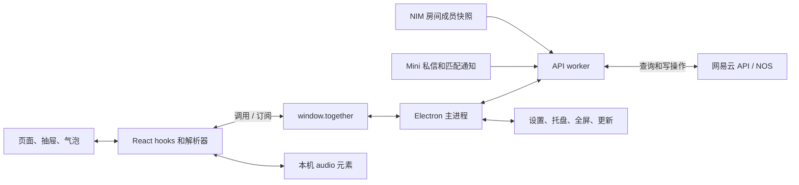

# Music Party UI 数据交接

本文供重做桌面界面的设计师、前端开发者和代码模型使用。基线为 `redesign/adaptive-player` 分支的 `0.13.1-adaptive.21` 工作区。表中列出当前客户端实际读取的字段、关联键和操作。布局、组件与交互约定见[单窗口界面规范](../UI-GUIDELINES.md)。

| 要解决的问题                                           | 从这里读起                                     |
| ------------------------------------------------------ | ---------------------------------------------- |
| 一个页面要传什么数据、按钮会改变什么？                 | 本页的页面表和交互流程                         |
| 哪些记录能关联？一个字段为空代表什么？                 | [实体、关联键、时间与呈现](models.md)          |
| 某个操作接受哪些参数，返回哪个字段，调用哪条上游路径？ | [48 个业务方法](api.md)                        |
| 哪些是推送，哪些是本机能力？如何播放、传附件、存设置？ | [34 个桌面桥接成员（含 9 个订阅）](desktop.md) |
| 离线画原型或做组件测试用什么数据？                     | [一组相互关联的虚构 JSON 样例](examples.json)  |

## 数据从哪里来

`App` 创建同一套 `useParty`、`useLibrary`、`useRoomChat`、`usePrivateMessages`、`useDesktop`，传给页面、抽屉和通知气泡。重排界面可以直接沿用这些状态持有者。例如，一个屏幕同时出现底栏和全屏播放器时，两处都读同一个 `p.current`、`p.playing` 和音频元素。新建第二个 hook 实例会启动另一套定时器和订阅。[应用入口](../../src/renderer/src/App.tsx)

业务请求在组件里通常写成 `await p.api(method, args)`。它拆开 IPC 的 `Reply`，返回下文称为 `body` 的值，失败则抛出带 `code` 和 `deliveryUnknown` 的错误。列表解析器将 `body` 转成可渲染的实体。音频进度、输入草稿和抽屉显隐由客户端维护。Cookie、IM 凭据、上传凭据由后台持有。[请求入口](../../src/renderer/src/useParty.ts) · [业务接口](api.md) · [类型定义](../../src/shared/types.ts)

## 页面、数据与动作

| 页面或入口                         | 组件需要的数据                                                                                                                     | 用户动作与数据来源                                                                                                                                                                                                                                                                                                                                                |
| ---------------------------------- | ---------------------------------------------------------------------------------------------------------------------------------- | ----------------------------------------------------------------------------------------------------------------------------------------------------------------------------------------------------------------------------------------------------------------------------------------------------------------------------------------------------------------- |
| 应用外壳、侧栏、顶部导航           | 当前页面和导航历史、页面搜索状态、账号、私信未读、桌面窗口状态                                                                     | 单窗口按 CSS 视口宽度使用窄屏（小于 520 px）、中窗（520–1039 px）或宽窗（1040 px 起）布局。顶部搜索由页面决定范围，鼠标侧键沿导航历史前进或返回。[布局与导航](../../src/renderer/src/windows/useAdaptiveNavigation.ts) · [标题栏与侧栏](../../src/renderer/src/windows/AdaptiveShell.tsx)                                                                         |
| 登录、账号                         | `account` 的 profile、`qr.qrimg`、`qrStatus`、会话持久化说明                                                                       | 生成二维码，按状态等待手机确认，成功后重新读账号。换号时重新加载音乐库、通知和会话，释放旧房间及草稿。[账号流程](../../src/renderer/src/useParty.ts)                                                                                                                                                                                                              |
| 正在播放、底栏、歌词               | `p.current`、`playing`、`position`、`volume`、`auditioning`、`library.likes`、`roomPlayback`、`roomReaction`、成员列表             | 底栏和沉浸式播放页共用音频状态。按当前曲 ID 加载原词与译词，按毫秒时间配对。歌手／作曲者有 ID 时可打开其歌曲。房间点赞在播放栏显示总数和本人的状态。[播放页](../../src/renderer/src/player/ImmersivePlayer.tsx) · [底栏](../../src/renderer/src/player/PortraitPlayer.tsx) · [歌词](../../src/renderer/src/Lyrics.tsx)                                            |
| 全站搜索                           | `SearchKind`、关键词、结果和总数、当前 offset、本机搜索历史                                                                        | 歌曲、歌单、歌手分别分页。歌曲 ID 可直接查详情。歌单和歌手结果打开应用内歌曲集合。[搜索与详情](../../src/renderer/src/MusicBrowser.tsx)                                                                                                                                                                                                                           |
| 我的歌单、收藏的专辑、我喜欢的音乐 | `library.playlists/albums/likes`、`likesReady`、集合的 `ids/songs/total/more/unavailable`                                          | 歌单目录可按创建者筛选，专辑目录也可过滤。喜欢页优先取本账号喜欢歌单的完整曲序。详情区按歌名、歌手和专辑过滤，会继续补齐未加载的页。过滤结果播放使用对应的歌曲 ID。[音乐库](../../src/renderer/src/useLibrary.ts)                                                                                                                                                 |
| 最近播放、定位当前曲               | 本账号（或访客）的最近歌曲 ID、当前歌曲 ID、当前集合与可见范围                                                                     | 歌曲实际开始播放后，在本机按 ID 去重保留最近 100 首。歌单、专辑等集合中仅在当前曲属于列表且离开视口时提供定位，必要时先补载其所在页。[最近播放](../../src/renderer/src/useRecentTracks.ts) · [定位当前曲](../../src/renderer/src/PlayingSongLocator.tsx)                                                                                                          |
| 添加到歌单                         | 打开时的歌曲与账号、可写歌单、所选歌单 ID 集合、每个目标的写入结果                                                                 | 可跨筛选多选本人创建的普通歌单。顶部确认后按目标各发一次 playlistAdd，分别标记新增、已有或失败。部分失败仅保留失败项供重试。[添加到歌单](../../src/renderer/src/AddToPlaylist.tsx)                                                                                                                                                                                |
| 开房、匹配、邀请、恢复             | `matchSong`、`allowStrangerMatch`、`matching/matchPhase`、邀请预览、`availableRoom`、当前 `room`                                   | 未进房时可恢复已有房间、建房／匹配或粘贴邀请。进房后从房间信息查看人数、类型、创建者、音乐标签。切换匹配用歌曲打开在线搜索，结果只读显示已知红心状态，选歌后再执行建房或重新匹配。[房间入口](../../src/renderer/src/player/RoomSetup.tsx) · [房间信息](../../src/renderer/src/windows/PanelPages.tsx) · [选歌](../../src/renderer/src/player/MatchSongPicker.tsx) |
| 队列抽屉                           | 个人队列用 personalQueue、personalIndex、repeatMode。房间队列用 roomPlayback、multiQueue 和 multiPlayed；可见曲目的详情补充歌手 ID | 个人队列可切曲、清空或切换播放方式。房间的「正在听」区分当前曲与待播推荐，可顶歌或删除自己的待播记录。「听过的」单独分页，排除当前推荐。署名有 ID 时可跳转。[队列](../../src/renderer/src/player/QueueDrawer.tsx)                                                                                                                                                 |
| 房间成员及个人推荐记录             | `onlineCount`、`members`、`membersStatus`、当前推荐记录、`played/waiting` 两个完整集合                                             | 按 UID 进入成员详情，每次推荐按业务 ID 计数。列表可以只出现部分在线用户。详情中的当前曲归入已播。[成员抽屉](../../src/renderer/src/player/MembersDrawer.tsx)                                                                                                                                                                                                      |
| 房间聊天                           | `chat.messages/unread/more/loading/lastUpdate/draft/sending/error`、当前 UID、房间和成员                                           | 文本、成员提及、表情、图片和房间动态共用时间线。向上滚动补旧页。动态里的歌曲直接显示在这一条活动内，避免另加重复预览卡。[房间聊天](../../src/renderer/src/RoomChat.tsx) · [卡片](../../src/renderer/src/ChatMessageCard.tsx)                                                                                                                                      |
| 私信列表、关注联系人、会话详情     | `inbox.conversations/contacts/selected/messages/unread`、在线三态、分页和草稿                                                      | 列表按在线优先排序，可从关注列表发起会话。邀请绑定一个对端，确认后单发。发送、历史、联系人和已读分别有错误状态。[私信页面](../../src/renderer/src/PrivateMessages.tsx)                                                                                                                                                                                            |
| 播放页私信通知与快捷回复           | 同一 inbox 的 notificationInbox、selected 和 messages                                                                              | 私信页在各尺寸均为主页面。新私信 toast 最多同时显示三个对端，点击其中一个才打开该对端的快捷回复。关闭通知和标记会话已读分别处理。[通知入口](../../src/renderer/src/App.tsx) · [收信逻辑](../../src/renderer/src/usePrivateMessages.ts)                                                                                                                            |
| 消息资源、发送附件、表情库         | `MessageAttachment`、`MultiInvitation`、`MediaTarget`、草稿、进度、云表情分组和游标                                                | 一条消息内的文字、图片、邀请或资源共用同一条记录。歌曲和专辑可在应用内打开。Unicode 表情、颜文字和自定义表情各有入口，最近使用的自定义表情按账号本地保存。[消息内容](../../src/renderer/src/MessageContent.tsx) · [输入框](../../src/renderer/src/ChatComposer.tsx) · [表情库](../../src/renderer/src/EmojiPicker.tsx)                                            |
| 设置、背景、版本更新、观测记录     | `DesktopInfo.preferences`、背景编辑草稿、`UpdateState`、`Trace[]`                                                                  | 界面提供中英文、主题、显示比例、主题色、壁纸和底色透明度等设置。播放条调音量，个人队列切播放方式，两者也由桌面偏好保存。观测记录支持查看请求和导出脱敏 JSON。[设置](../../src/renderer/src/Settings.tsx) · [桌面偏好](desktop.md) · [观测记录](../../src/renderer/src/Diagnostics.tsx)                                                                            |

## 播放控件的三种上下文

| 操作             | 个人播放                         | 房间跟听                                                                   | 房间内本机试听                                       |
| ---------------- | -------------------------------- | -------------------------------------------------------------------------- | ---------------------------------------------------- |
| 主播放按钮       | 播放／暂停本机音频               | 暂停或恢复本机收听，恢复时重新对齐房间                                     | 停止试听，返回房间当前曲和进度                       |
| 歌曲列表点播放   | 以选择的歌曲和集合 ID 建个人队列 | 推荐一条歌曲到房间，等待服务器安排                                         | 试听动作可以切换本机试听曲，房间推荐仍走房间接口     |
| 拖进度、点歌词   | 本机 seek                        | 房间时间线由服务端维护                                                     | 在试听文件内本机 seek                                |
| 下一首／播到结尾 | 按个人队列和循环模式处理         | 用户点切歌提交当前业务 ID。自然结束只重新查询房间状态                      | 下一首按钮或试听自然结束，回到此刻的房间时间线       |
| 红心与点赞       | 红心保存到个人喜欢               | 个人红心仍归账号，给当前歌曲新增红心可同步一条房间活动。房间点赞可重复点击 | 红心依据屏幕上试听的歌曲，房间点赞控件受试听状态约束 |

播放器头图、标题和歌词随本机 `current.id`。房间成员详情和推荐操作随 `roomPlayback.song.songBizId`。试听时两者可以指向不同歌曲，期间后台仍接收房间心跳。[播放控制](../../src/renderer/src/useParty.ts) · [房间播放器](../../src/renderer/src/room-player.ts) · [自然换曲](../../src/renderer/src/room-transition.ts)

### 重开应用与主动离房

- 按账号保存个人队列的歌曲 ID 顺序、当前索引及当前曲元数据，重开后恢复选择并暂停，进度从零开始。
- 关闭客户端时保留房间关系。再次登录后查询 multiStatus，房间与本账号记住的 ID 一致时自动接回；其他可用房间显示手动恢复入口。
- 主动离开正在跟听的房间时，先完整分页读取已播和待播。退出成功后把已播、当前和待播按顺序转成个人队列，延续当前曲进度与本机播放／暂停状态。重新匹配使用单独的换房流程。详见[本机队列存储](../../src/renderer/src/playback-session.ts)和[离房队列转换](../../src/renderer/src/room-queue-handoff.ts)。

## 刷新、推送和写入时机

| 数据           | 首次与后续来源                                                                                                                                                       | UI 要保留的语义                                                                                                                                |
| -------------- | -------------------------------------------------------------------------------------------------------------------------------------------------------------------- | ---------------------------------------------------------------------------------------------------------------------------------------------- |
| 登录状态       | 启动读 `account`。二维码首次约 2 秒后检查，之后约每 2.5 秒一次                                                                                                       | 过期可重建，扫码待确认与登录成功为不同状态                                                                                                     |
| 房间时间线     | 建房、加入、恢复和状态查询都可能返回快照。房间心跳由 `heartBeatDuration` 指定，默认 5 秒，范围 1–60 秒                                                               | `version` 与本地采样时间同时约束新旧。断网、挂起或切房后丢弃旧请求。心跳错误退避，488 清理当前房间                                             |
| 房间人数和头像 | NIM 聊天室的 30005 成员事件经 `onRoomMembers` 到达。另有每 10 秒一次的 `multiStatus` 和显式刷新                                                                      | 人数可能先变，头像在稍后的推送或 HTTP 快照中补齐。人数用 `onlineCount`，名单用 `members`，只为已返回的成员绘制头像。成员版本和播放版本各自比较 |
| 匹配           | 先打开 Mini 匹配订阅，再提交匹配。客户端约每秒取一次已收到的本地事件，并约每 2.5 秒查询恢复状态                                                                      | `ready` 才发加入 ACK。状态查询只对明确的 `RECONNECT_SUCCESS` 执行恢复。取消后忽略迟到通知                                                      |
| 房间聊天       | 加入房间后读历史。面板可见约 3 秒、收起约 8 秒刷新最新页，发送后也刷新                                                                                               | 旧历史和最新页分开合并。首次加载不计入未读，面板打开清本地未读。成员推送自身不会生成聊天行                                                     |
| 私信与在线     | 后台 Mini 推送，启动与恢复读一次本地事件缓冲。私信页／回复气泡可见且窗口聚焦时，每 10 秒补读会话与选中历史，收到事件可提前刷新。联系人在线缓存 45 秒，失败退避 30 秒 | 后台可更新角标、预览和气泡。读历史后，仅对有焦点的已打开会话确认已读。在线是对端查询结果，应用未实现本账号在线上报                             |
| 音乐列表与表情 | 搜索、集合、联系人、历史和表情面板按各自的分页规则加载。歌单目录、收藏专辑目录、成员推荐统计会连续取页                                                               | 首屏加载、已取得部分数据、加载下一页、完整空列表、分页失败须可区分。顶部追加旧消息时保留滚动位置。分页协议见接口表                             |

### 可复用的交互例子

1. **一首歌被推荐两次。** 搜索结果取 `Song.id`，推歌传 `roomId + songId`。服务器返回不同的 `songBizId`，待播行和当前曲分别绑定各自的业务 ID。点“顶歌”时传所点行的两个 ID。成员统计也保留这两次推荐。
2. **从播放页回复私信。** 推送根据 `accountUid` 选账号，以 `peerUid` 更新会话。点击该通知打开快捷回复后取该对端的历史，以 `server:<id>` 合并真实消息，再确认已读。每次发送有独立 `requestId`。切换收件人后，已开始的附件仍归原对端。
3. **异步返回时用户已换页或换号。** 详情、搜索和分页结果按来源及请求代次提交。添加到歌单保存打开弹窗时的歌曲与账号。换号切换到新账号自己的队列并清理旧订阅和会话草稿，过期结果不会回填到新账号。

## 用样例核对原型

[examples.json](examples.json) 的 `calls` 是业务请求和成功的 IPC 回包，`events` 是 preload 回调参数，`desktop` 是桌面状态查询结果，`failures` 是业务失败回包。离线原型模拟 `window.together.call` 时返回 `reply`。模拟 `p.api` 时成功返回 `reply.data`，失败则抛错。下面的画面共用这组样例，桌面部分给的是某位用户的偏好值。出厂默认值见[桌面偏好](desktop.md)。

- 房间先显示 2 人、1 个已知头像，下一次成员推送补齐 2 个头像，播放进度不跳变。
- 当前曲和待播曲共享曲库 ID，显示不同的推荐者。当前用户个人红心与房间的点赞数分别呈现。
- 主动离房时，推荐记录按 7100（已播）、7101（当前）、7102 和 7103（待播）排序。7101 和 7102 共享曲库 ID，个人队列应保留两次出现并指向前一次。
- 私信预览出现后，打开同一对话才看到完整历史。超时的发送保留“结果待确认”，避免重复发信。

修改样例后可运行 `pnpm exec vitest run tests/ui-data-examples.test.ts`。该测试核对业务请求参数、退房队列里当前歌曲的位置、歌词与译文时间戳，以及桌面设置的完整性，也随 `pnpm run check` 执行。[样例测试](../../tests/ui-data-examples.test.ts)

要继续追查行为，可从仓库的自动化场景找入口。[多人生命周期](../../tests/desktop/app.spec.ts) · [成员和推荐](../../tests/desktop/members.spec.ts) · [通知与回复](../../tests/desktop/private-notifications.spec.ts) · [音乐库与收藏](../../tests/desktop/library.spec.ts) · [附件与预览](../../tests/desktop/media.spec.ts) · [全局背景](../../tests/desktop/background.spec.ts)
