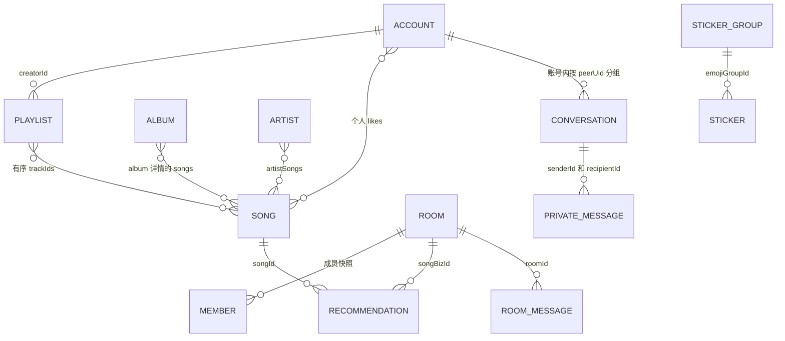

# 实体、关联键与缺省状态

下面的 UI 字段是项目现用的 TypeScript 名称。表中的箭头从服务端原始字段指向渲染模型。ID 一律作为字符串关联，特别是 UID、歌曲、推荐记录、消息及表情 ID，部分服务端值会超出 JavaScript 的安全整数范围。名称、头像和歌曲标题都允许重复。[公共类型](../../src/shared/types.ts) · [关联样例](examples.json)

## 先区分这些键

| 想找到什么                         | 用哪个键                                                                                                           | 示例中的关联                                                                                             |
| ---------------------------------- | ------------------------------------------------------------------------------------------------------------------ | -------------------------------------------------------------------------------------------------------- |
| 当前账号和另一位听友               | `String(profile.userId)`。成员、私信对端、关注联系人和推荐者都使用同一 UID 命名空间                                | 当前账号 `1101`，私信对端与房间成员 `1102`。两者的“在房间”和“私信在线”分别取数                           |
| 哪首歌曲                           | `Song.id` 对应 `QueueSong.songId`、待播行的 `songInfo.resourceId`、歌单的 `trackIds[].id`、歌曲附件的 `resourceId` | `4101` 同时出现在喜欢列表、当前曲和待播曲中                                                              |
| 哪一次推荐、顶歌、切歌或房间点赞   | 房间内 `songBizId`，来自快照的 `songBizId` 或列表的 `songInfo.bizId`。写操作的参数名为 `bizId`                     | `7101` 和 `7102` 都指向曲库里的 `4101`，但推荐者和互动状态不同                                           |
| 哪个房间、哪个聊天室               | `Room.roomId` 用于业务接口和邀请。`Room.chatRoomId` 用于后台订阅成员事件                                           | `room_demo` 对应聊天室 `8101`。发送房间消息时 renderer 传业务 roomId                                     |
| 谁与谁的私信                       | 本账号 UID 加 `Conversation.uid`（对端）。用消息的 `senderId/recipientId` 确定方向                                 | `1102 → 1101` 是对端发来的消息。收藏歌单的创建者、关注对象、房间成员皆可与对端资料重合                   |
| 哪一次本地发送、对应哪条服务器消息 | `requestId` 标识本地发送和上传进度。私信服务端 `msgId/id`、房间历史的发送者和时间标识真实记录                      | 通知的 `messageId:"9101"` 与历史行 `id:"server:9101"` 对应。通知事件自身还有另一项用于去重的 `notice.id` |
| 哪个表情                           | `emojiGroupId` 关联分组。有正式身份时按 `emojiId`，值为 `"0"` 时按图片身份识别                                     | 图片可直接发送，只有实际有 ID 的自定义表情才能按 emojiId 提交删除                                        |

推荐记录的 `songRcmdUid` 可以对应一名成员、已离房用户或系统 `"0"`。因此即使成员列表尚无此 UID，推荐记录仍应显示。上图是 UI 可查到的关联。歌曲通过 `albumId` 跳转专辑，通过艺人或作曲署名中的有效 ID 跳转音乐人曲目页。缺少 ID 的署名按原名展示。

## 账号、音乐库与歌词

| 模型         | 渲染字段                                                                                     | 映射和使用方式                                                                                                                                                                                             |
| ------------ | -------------------------------------------------------------------------------------------- | ---------------------------------------------------------------------------------------------------------------------------------------------------------------------------------------------------------- |
| 登录 profile | `userId,nickname,avatarUrl`                                                                  | `account` 回包的 `data.profile`。当前账户为空时显示登录入口，独立的 `sessionInfo.persistent` 决定是否提示下次要再扫码                                                                                      |
| `Song`       | `id,name,artist,artists?,composers?,album,albumId?,cover,duration`                           | `ar / artists` 保留各自的署名和有效 ID，`artist` 是合并的显示名。`composers` 保存单独的作曲署名。每项是 `MusicianCredit{name,id?}`，有 ID 可跳到相应歌手歌曲页。专辑跳转使用 albumId。dt / duration 为毫秒 |
| `Playlist`   | `id,name,cover,count,creatorId,creator,specialType`                                          | `trackCount → count`，`creator.userId/nickname → creatorId/creator`。creatorId 匹配当前 UID 且 specialType 为 5 时是喜欢歌单。本人创建且非 5 的列表可作为添加目标                                          |
| `Album`      | `id,name,cover,artist,count`                                                                 | `picUrl → cover`，`artists[].name → artist`，`size → count`。收藏专辑目录和专辑详情的歌曲分别读取                                                                                                          |
| `Artist`     | `id,name,cover,aliases[]`                                                                    | 搜索结果的 `picUrl` 或 `img1v1Url`、`alias`。用 artist.id 读其歌曲                                                                                                                                         |
| 歌曲集合     | `ids[],songs[],total,unavailable,loading,more,error`                                         | 歌单先有完整 ID 顺序，Song 详情可以逐批取得。歌手集合会随分页增长。已加载首数、总数和缺失首数含义不同                                                                                                      |
| `LyricLine`  | `time,text`。译词另存为 `Map<number,string>`                                                 | 分别解析原词与译词的 LRC 时间标签及 offset。按本机 position 选中原词，以行时间精确匹配译词。一行可有多个时间标签                                                                                           |
| 个人播放状态 | `current:Song或null,personalQueue:string[],personalIndex,repeatMode,position,playing,volume` | 主动离房时，按已播、当前、待播顺序转为个人队列。以索引区分重复歌曲，延续当前进度和本机播放或暂停状态。循环为 order、loop 或 single                                                                         |

红心由当前账号的 likes 提供，likesReady 表示已取回。喜欢页曲序优先使用喜欢歌单的 trackIds，缺此歌单时再使用喜欢 ID 集合。切换匹配用歌曲时只展示已知红心状态。全站搜索用本机共用的 `music-party-search-history`，匹配选歌用按账号分开的 `music-party.match-song-search-history.<uid>`。两者各去重保存最近 10 项。[歌曲转换](../../src/shared/protocol.ts) · [集合分页](../../src/renderer/src/useLibrary.ts) · [搜索历史](../../src/renderer/src/SearchHistory.tsx) · [匹配选歌](../../src/renderer/src/player/MatchSongPicker.tsx)

## 多人房间与推荐

| 模型              | 渲染字段                                                                                                        | 映射和使用方式                                                                                                                                                                                       |
| ----------------- | --------------------------------------------------------------------------------------------------------------- | ---------------------------------------------------------------------------------------------------------------------------------------------------------------------------------------------------- |
| `MultiInvitation` | `roomId,inviterUid,isFLT:false`                                                                                 | 可由官方多人分享链接或私信卡解析。预览另有 `roomStatus,inviter,songData`。实际加入由服务器确认                                                                                                       |
| `Room`            | `roomId,inviterUid,role,chatRoomId?,roomBizType?,creatorUid?,creatorName?,tags?`                                | role 为 host、guest 或 unknown。类型 1 私密好友、2 公开好友、3 公开匹配，其余保留未知。创建者、邀请者和每首歌的推荐者分别使用各自的 UID                                                              |
| `RoomSnapshot`    | `roomId,playback,members[],membersKnown,onlineCount,chatRoomId,roomBizType?,creatorUid?,creatorName?,tags?`     | 分别解析 roomPlaySongInfo、multiLtRoomUserAgg 和 multiRoomInfoDTO。以 creatorId 在在线成员或 roomUsers 中找昵称，可用邀请预览的 roomCreator 补足；标签取快照或待播接口的 roomTagList                 |
| `Member`          | `uid,nickname,avatar`                                                                                           | 成员来源为 `onlineUserInfos` 或房间信息的 `roomUsers`。按 UID 去重。缺失头像可绘制占位，缺昵称可显示“听友”                                                                                           |
| `LtMemberUpdate`  | `roomId,version,onlineCount,members[]`                                                                          | NIM 的 `onlineNums` 是人数，`onlineUserInfos` 是可显示的成员。版本取 version 或 serverSeq，事件可缺业务 roomId（解析结果为空串）。HTTP 快照通过独立路径补偿                                          |
| `QueueSong`       | `songId,songBizId,songRcmdUid`                                                                                  | 轻量引用，供当前及下一批歌曲使用。推荐者 `"0"` 为系统推荐                                                                                                                                            |
| `RoomPlayback`    | `song或null,nextSongs[],version,playedTime,duration,sampledAt,forceSync,waitSongCount,likeCount?`               | `playSong → song`，`songDuration → duration`，`playingSongZanCnt → likeCount`。当前位置约为 playedTime 加本地采样后的流逝时间，并按 duration 限幅。nextSongs 是摘要，完整队列取 multiQueue           |
| `RoomQueueEntry`  | `QueueSong` 的三个 ID，加上 `track:Song,recommender,selfRecommended,uped,upCount,upCountKnown?,liked,likeCount` | 从 `songInfo.{resourceId,bizId,title,coverUrl,artistName,upCnt,zanCnt}`、`rcmdUid,nickname,selfRcmd` 等组装。队列给的 track 可以没有专辑和时长。顶歌状态优先用 songInfo.uped，条目级 uped 是兼容来源 |
| 当前房间点赞      | `roomReaction.{liked,count,loading}`                                                                            | 按账号、房间与当前推荐的 songBizId 绑定。播放栏角标合并状态详情与心跳计数，仅本人已点时高亮，试听期间禁用。喜欢歌曲由 library.likes.has(songId) 单独提供                                             |

房间当前曲按 `songBizId` 从待播列表排除。成员详情按 UID 分组两套记录，当前曲即使尚未出现在已播接口也纳入已播，同一推荐跨列表只计一次。队列推荐者显示优先取匹配 UID 的条目昵称或成员昵称，缺少时可回退到用户 ID。详情还可以为已离房的当前推荐者保留入口。[队列解析](../../src/shared/playback-queue.ts) · [成员统计](../../src/renderer/src/member-recommendations.ts) · [队列显示](../../src/renderer/src/player/QueueDrawer.tsx)

## 聊天、会话与资源卡

| 模型                             | 渲染字段                                                                                                                                                        | 映射和使用方式                                                                                                                                                           |
| -------------------------------- | --------------------------------------------------------------------------------------------------------------------------------------------------------------- | ------------------------------------------------------------------------------------------------------------------------------------------------------------------------ |
| `ChatPage` / `ChatMessage`       | 页为 `messages[],more,cursor`。行有 `id,roomId,uid,nickname,avatar,time,text,kind`，可带 `interactType,attachments[],richText[],emoji,delivery,error,echoAfter` | 历史按 roomId 和 onlyCanSeeUserIds 筛选。真实行 ID 为 `发送者UID:sendTime`，本地待确认行为 `local:requestId`。kind 为 text、notice、image、resource、interaction         |
| `RoomActivityPresentation`       | `type,label,icon,text,parts[]`，每个 part 有 kind 和 text                                                                                                       | 官方动态区分加入、离开、推荐、顶歌、点赞、红心、通告。actor、song、text 片段用于活动行排版。优先用已有资源标题，未知模板保留原文                                         |
| `Conversation`                   | `uid,nickname,avatar,preview,time,unread,online?`                                                                                                               | 由最近消息两端选出对端。`lastMsgTime → time`，`newMsgCount → unread`。列表把明确在线者排前面，然后按时间倒序、UID 排同序。总角标来自已加载会话的未读和                   |
| `PrivatePeer`                    | `uid,nickname,avatar,online:boolean或null`                                                                                                                      | 查询一位对端的在线状态。房间在线人数、Mini 连接状态和“我关注了他”都不能推出该字段                                                                                        |
| `PrivatePage` / `PrivateMessage` | 页为 `messages[],more,before`。行有 `id,senderId,recipientId,time,text,invitations[]`，可带 `attachments[],richText[],delivery,error,echoAfter`                 | 只保留本人和当前对端之间的双向记录。有真实 ID 就用 `server:<id>`，否则使用发送方、接收方、时间和内容的组合键。历史正序，新消息在底部                                     |
| `ReadBoundary`                   | `time,messageIds[]`                                                                                                                                             | 记录已载入对端最新服务器消息的时间，及同毫秒的所有已读 ID。新通知抵达时据此保留尚未读过的消息                                                                            |
| `MessageTextPart`                | `text,emphasized,url?`                                                                                                                                          | 按文本段显示强调或可点击链接                                                                                                                                             |
| `MessageAttachment`              | `kind,title,subtitle?,url?,cover?,resourceType?,resourceId?,actionUrl?,width?,height?,emoji?`                                                                   | kind 为 image、audio、video、resource、file。url 用作媒体源，cover 是预览图，actionUrl 是跳转动作。确认是 song 或 album 的资源走应用内流程。其他可用链接按既有处理器打开 |
| `ChatEmoji` / `SavedSticker`     | `emojiId,emojiGroupId,emojiName,emojiImgUrl,width,height,format`。云表情另有 `picId,restricted,restriction`                                                     | 受限表情显示不可用原因。表情分组是 `StickerGroup{id,name,editable}`。表情库按账号、room/private 场景、组和游标缓存                                                       |

发送状态按 `sending → submitted → 服务端历史行` 展示。明确失败为 `failed`，提交后结果未知为 `uncertain`，错误文案在 error。历史回显与乐观行一对一归并，连续发送相同内容也可能是两条有效消息。房间和私信使用各自的合并函数。[房间消息](../../src/shared/chat.ts) · [活动呈现](../../src/shared/room-activity-presentation.ts) · [私信消息](../../src/shared/private-messages.ts) · [已读与排序](../../src/shared/private-activity.ts) · [资源跳转](../../src/shared/message-resource.ts)

## 三种时间和几类空值

| 字段或状态                                                                                  | 正确的 UI 解释                                                                                                   |
| ------------------------------------------------------------------------------------------- | ---------------------------------------------------------------------------------------------------------------- |
| `Song.duration,RoomPlayback.duration,playedTime,position,LyricLine.time,MediaFile.duration` | 媒体时间为毫秒。HTML audio 的 currentTime/duration 是秒，在现有播放层完成换算                                    |
| `RoomPlayback.sampledAt`                                                                    | 来自 performance.now() 的本地单调时钟，只用于估算进度。不要转换为日期展示                                        |
| 消息的 `time`、通知的 `timestamp`、私信分页 `before`                                        | Unix 毫秒时间戳，可转成本地时间。房间及表情的字符串 cursor 与它们无换算关系                                      |
| `onlineCount === null`、`membersKnown === false`                                            | 人数未知、服务端未给成员数组。已有可用的成员可以保留。得到空数组表示本次确实有列表。已知人数与名单长度仍允许不同 |
| `online === null/undefined`                                                                 | 暂无可用在线状态。只有 true 显示在线，false 为明确离线                                                           |
| `playback === null` 与 `playback.song === null`                                             | 前者尚无可用时间线，后者已取得时间线且当前无曲。不要用未知待播数绘制“0 首”                                       |
| `upCountKnown === false`                                                                    | 顶歌次数缺失，保留按钮即可。明确的 upCount=0 可以显示数字 0                                                      |
| `more === true` 但下个 cursor 缺失或重复                                                    | 分页异常，保留已加载条目、提供重试。空首屏、权限或加载错误应有各自的呈现                                         |
| `freeTrialInfo` 有效或音源 URL 缺失                                                         | 显示与当前账号相符的试听或不可播放状态。资源卡的存在只说明拿到了元数据                                           |

桌面偏好、上传回执与通知批次也有独立字段表。[桌面数据](desktop.md)
